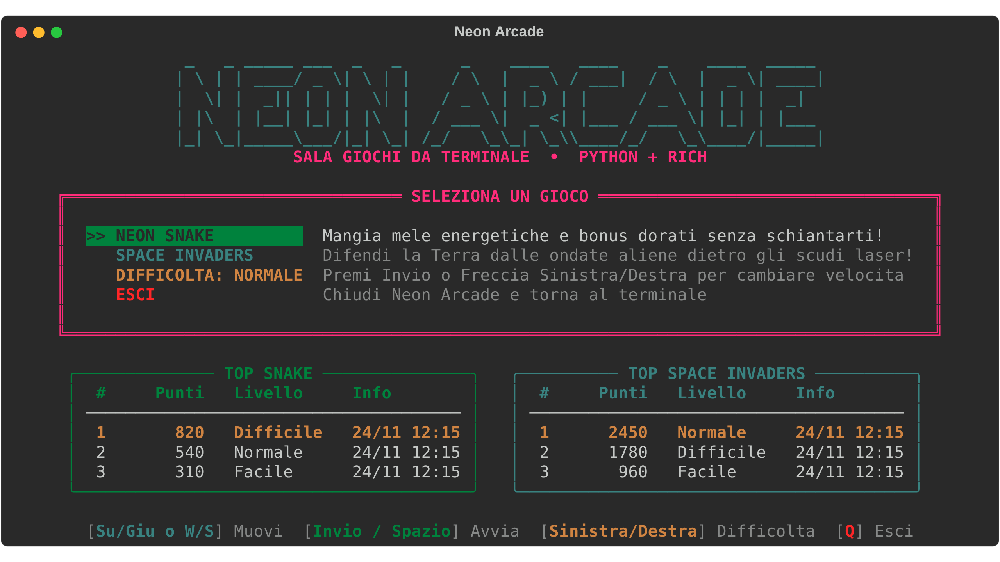
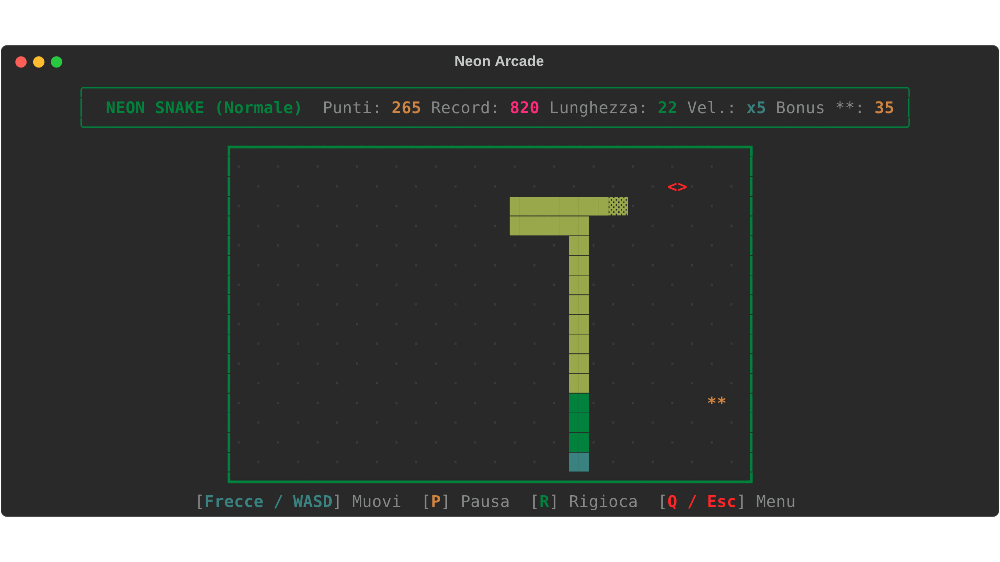
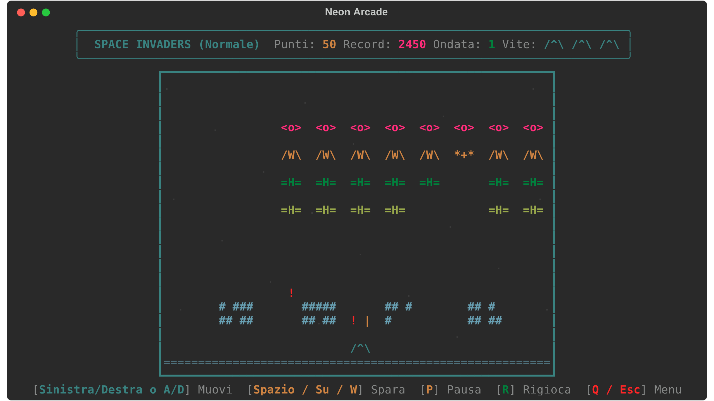

# Neon Arcade

Sala giochi arcade in tempo reale nel terminale, scritta in **Python** con **Rich**.  
Compatibile con **macOS, Linux e Windows** (consigliato Windows Terminal su Windows).



| Neon Snake | Space Invaders |
| --- | --- |
|  |  |


## Requisiti

- Python `3.9+`
- Libreria `rich` (`pip install rich`)

## Giochi inclusi

- **Neon Snake**: serpente neon con coda di input reattiva, accelerazione progressiva e stelle bonus dorate a tempo (`**`).
- **Space Invaders**: ondate di alieni animati, scudi laser distruttibili, UFO misterioso (`<===>`), vite, esplosioni e difficoltà scalabile.
- **Classifiche locali**: salvataggio automatico dei Top 5 record per ogni gioco in `highscores.json`.

## Avvio rapido

```bash
python3 main.py
```

Oppure avvia direttamente un gioco specifico:

```bash
python3 main.py --game snake --difficulty Normale
python3 main.py --game invaders --difficulty Difficile
```

## Controlli

| Tasto | Azione |
| --- | --- |
| `Frecce` / `WASD` | Muovi (menu, Snake, navicella) |
| `Spazio` / `Invio` | Conferma nel menu / Spara in Space Invaders |
| `P` | Pausa |
| `R` | Riavvia partita |
| `Q` / `Esc` | Torna al menu / Esci |

## Test

```bash
python3 -m unittest discover -s tests -v
```
